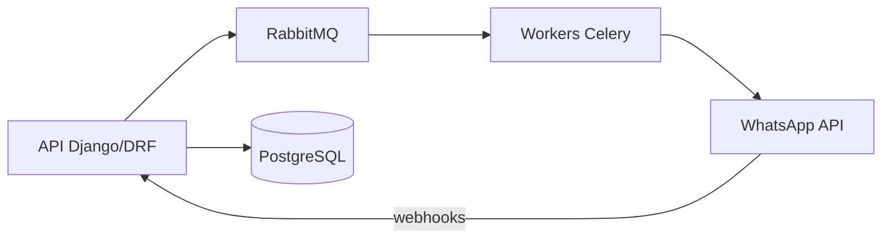

# Kayo Libarino

Engenheiro de Software Sênior com **10+ anos** de experiência em **backend com Python, Django e APIs REST**.
Bacharel em Ciência da Computação (UESB) · Residência em Software no CIn/UFPE

## Atual: [Lys Academy](https://www.lys.academy/site/)

Plataforma B2B de microlearning corporativo via WhatsApp. Cuido do backend, da API à produção.

- **+10 milhões de mensagens** processadas com Celery e RabbitMQ
- APIs REST em Django/DRF, integração com WhatsApp Business API e pipelines no Apache Airflow
- IA aplicada com a OpenAI Responses API

## Projeto: [Ceps Brasil](https://cepsbrasil.com.br/)

API Django + PostgreSQL com **1 milhão+ de CEPs** e frontend Next.js com **~100 mil visitas/mês**. Produto próprio, em produção.

## Tecnologias

  
  
  
  
  
  
  
  
  
  
  

## Contato

  
  
  

